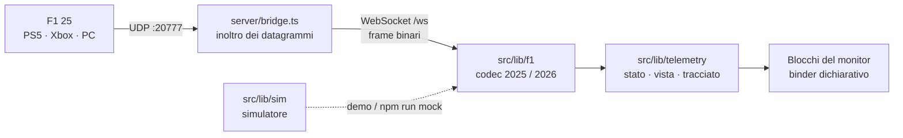

<div align="center">


# Formula Monitor

**Il muretto box di F1 25, sul tuo schermo.**

Telemetria live di F1 25 (PS5 · Xbox · PC) in qualsiasi browser di casa: timer della sessione,<br />
classifica con settori e distacchi, delta, gomme, power unit, live feed e pedali. Pensato per il 9:16, funziona anche a 16:9.

[](https://github.com/rkarmaaa/formula-monitor/actions/workflows/ci.yml)


</div>

---

## ✨ In breve

|                            |                                                                                                                                                 |
| -------------------------- | ----------------------------------------------------------------------------------------------------------------------------------------------- |
| 📡 **Live dal gioco**      | Un'app per Windows e macOS (un solo file) riceve l'UDP di F1 25 e lo porta in qualsiasi browser di casa: PC, telefono, tablet, secondo monitor. |
| ⏱️ **Qualifica in chiaro** | Timer della sessione e classifica di tutti i piloti con giro migliore, distacco e S1·S2·S3: viola il migliore assoluto, verde il personale.     |
| ⏳ **Attesa che spiega**   | Finché la sessione non parte il monitor dice cosa manca: PC non raggiungibile, nessun dato UDP, formato sbagliato.                              |
| 🎮 **Due formati**         | F1 25 (formato 2025) e Season Pack 2026 (22 auto): riconosciuti automaticamente.                                                                |
| ◼️ **Grafite**             | Design geometrico in bianco e nero, spigoli vivi; il colore è solo dato.                                                                        |
| 🧪 **Simulazione**         | Dal footer della home: qualifica o gara simulate nel browser, con il selettore della schermata nella barra.                                     |

## 🚀 Avvio rapido

Scarica **[FormulaMonitor.exe](https://github.com/rkarmaaa/formula-monitor/releases/latest/download/FormulaMonitor.exe)**
(Windows 10/11) o lo zip per Mac ([Apple Silicon](https://github.com/rkarmaaa/formula-monitor/releases/latest/download/FormulaMonitor-macOS-AppleSilicon.zip),
[Intel](https://github.com/rkarmaaa/formula-monitor/releases/latest/download/FormulaMonitor-macOS-Intel.zip)) e aprilo: niente da installare. Si apre il monitor nel browser, in attesa, con l'IP del PC da
inserire nel gioco e l'indirizzo da aprire su telefono o tablet della stessa rete.

> 💡 Windows può avvisare che l'app non è riconosciuta (non è firmata): _Ulteriori informazioni → Esegui comunque_.
> Su Mac l'app non è notarizzata: se viene bloccata, _Impostazioni di Sistema → Privacy e sicurezza → Apri comunque_.
> Al primo avvio consenti l'accesso alle reti private, altrimenti i dati della console non arrivano.

Da sorgente serve **Node.js 22.18+** (consigliato 24): `npm install`, `npm run build`, `npm start`.

### 🎛️ Nel gioco

_Opzioni di gioco → Impostazioni → Impostazioni telemetria UDP_

| Opzione            | Valore                                                                    |
| ------------------ | ------------------------------------------------------------------------- |
| UDP Telemetry      | **On**                                                                    |
| UDP Broadcast Mode | **Off** (On solo per più dispositivi o app)                               |
| UDP IP Address     | **IP del PC** con Formula Monitor (`127.0.0.1` se giochi sullo stesso PC) |
| UDP Port           | **20777**                                                                 |
| UDP Send Rate      | **60 Hz** (30 Hz su Wi-Fi instabile)                                      |
| UDP Format         | **2025** per F1 25 · **2026** con il Season Pack                          |
| Your Telemetry     | **Public** (solo online, per mostrare i tuoi dati agli altri)             |

> 💡 Nel firewall di Windows consenti Formula Monitor sulle reti private (UDP 20777 in ingresso).

## 🌐 Sito e release

- `pages.yml` pubblica su GitHub Pages la presentazione del prodotto (`PUBLIC_TARGET=site`): download dell'exe,
  demo live del cruscotto e come funziona. Un sito non riceve UDP, quindi online il monitor è sempre in simulazione.
- `release.yml` a ogni push su `main` crea l'exe per Windows e gli zip per macOS (`npm run build:exe`, Node SEA, su
  runner Windows, macOS Apple Silicon e Intel) e li pubblica nella release
  `v<versione>`. La versione è automatica: `major.minor` da `package.json`, patch = commit successivi.

## 🛠️ Sviluppo

```bash
npm run dev                         # sito + bridge UDP sulla stessa porta → http://localhost:4321
npm run mock -- --session quali     # gioco finto via UDP (--format 2026 --rate 60 --laps 10)
npm test                            # codec, gara e qualifica simulate, tracciato appreso
npm run check                       # TypeScript e Astro: 0 errori, 0 warning, 0 hint
```

| Scorciatoia                   | Azione                                                |
| ----------------------------- | ----------------------------------------------------- |
| `/monitor/?demo`              | qualifica simulata nel browser, senza bridge né gioco |
| `?demo=race` · `&format=2026` | gara simulata · formato 2026                          |
| `F`                           | schermo intero                                        |
| `?bridge=IP:20780`            | collegati a un bridge su un altro PC                  |

## 🧠 Come funziona



- **Codec dichiarativo**: la stessa definizione legge e scrive i pacchetti; ogni dimensione è verificata nei
  test contro le specifiche ufficiali EA.
- **Circuiti**: forma reale dei circuiti per il tracciato appreso ([bacinger/f1-circuits](https://github.com/bacinger/f1-circuits), MIT)
  allineata alle coordinate del gioco con un fit di Procrustes; il tracciato osservato la sostituisce man mano.
- **Binder**: i blocchi sono markup con `data-text`, `data-var`, `data-attr`, `data-list`; solo il grafico dei
  pedali ha un renderer dedicato.
- **Simulatore**: Monza reale con profilo di velocità fisico, 20–22 auto, gara o qualifica.

<details>
<summary><b>📁 Struttura del progetto</b></summary>

```
server/            bridge UDP→WebSocket, avvio di produzione, mock UDP, integrazione dev
src/lib/f1/        codec binario e schema dei pacchetti 2025/2026
src/lib/telemetry/ stato, vista, tracciato appreso e allineamento della forma reale
src/lib/sim/       simulatore di gara e qualifica
src/data/          formati, forme dei circuiti, team, piste, dati demo
src/i18n/it.ts     tutti i testi dell'interfaccia
src/components/    home (illustrazione, tutorial), monitor (barra), blocchi del cruscotto
src/scripts/       runtime del monitor, binder, renderer dei pedali
src/styles/        design system SCSS (token, mixin, un partial per componente)
docs/              protocollo UDP ed elenco completo dei dati
```

</details>

<details>
<summary><b>📦 Scelte tecniche</b></summary>

| Libreria                               | Perché                                                                |
| -------------------------------------- | --------------------------------------------------------------------- |
| [Astro](https://astro.build)           | pagine statiche, componenti, SCSS e TypeScript senza framework client |
| [ws](https://github.com/websockets/ws) | WebSocket per il bridge (il browser non riceve UDP)                   |
| Geist + Saira                          | font self-hosted: testo pulito e numeri tabellari da cruscotto        |

Scartati i parser UDP esistenti per Node: decodificano solo lato server, non scrivono pacchetti (servono al
simulatore) e non coprono il formato 2026.

</details>

## 📚 Documenti

- [Come funziona la telemetria UDP di F1 25](docs/UDP-F1-25.md)
- [Tutti i dati mostrabili](docs/DATI.md)
- [Design system "Grafite"](DESIGN-SYSTEM.md)
- [Regole di sviluppo](CLAUDE.md)

## ⚖️ Note

Il bridge è pensato per la rete di casa: non ha autenticazione, non esporlo su Internet.

Progetto indipendente, non affiliato né approvato da Formula 1, FIA, Electronic Arts o Codemasters.
F1® è un marchio di Formula One Licensing BV. Forme dei circuiti © Tomislav Bacinger (MIT).
Foto della home: McLaren MP4/9 di Nathan Vaganay su [Pexels](https://www.pexels.com/photo/f1-mclaren-mp4-9-17491423/).
Licenza [MIT](LICENSE).
