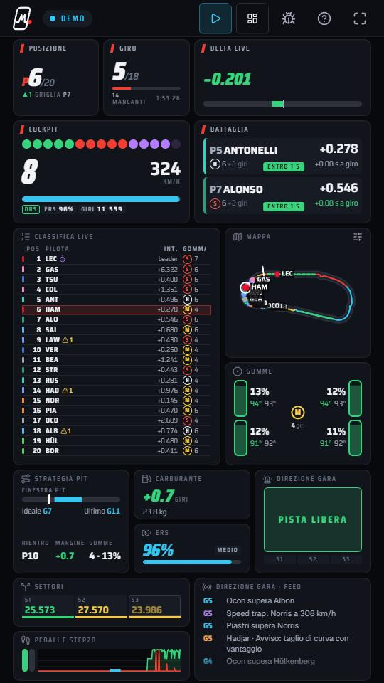

<div align="center">


# Formula Monitor

**Il muretto box di F1 25, in verticale.**

Telemetria live di F1 25 (PS5 · Xbox · PC) su un cruscotto a blocchi pensato per uno schermo 9:16:<br />
i dati che l'HUD del gioco non ti mostra, organizzati come preferisci.

[](https://github.com/rkarmaaa/formula-monitor/actions/workflows/ci.yml)




</div>

---

## ✨ In breve

|                                  |                                                                                                                                                                                                              |
| -------------------------------- | ------------------------------------------------------------------------------------------------------------------------------------------------------------------------------------------------------------ |
| 📡 **Live dal gioco**            | Un piccolo bridge Node riceve l'UDP di F1 25 e lo porta in qualsiasi browser di casa: telefono, tablet, secondo monitor.                                                                                     |
| 🧩 **26 blocchi**                | Di diverse dimensioni e importanza: sposta, ridimensiona, aggiungi, togli. Il layout si salva da solo.                                                                                                       |
| 🕵️ **Quello che l'HUD non dice** | Trend del distacco a giro e _"lo prendi in N giri"_, gomme ed età di ogni avversario, avvisi track limits, rientro previsto dai box, margine carburante, delta live metro per metro, usura della power unit. |
| 🗺️ **Mappa vera**                | Il gioco non invia il tracciato: Formula Monitor lo ricostruisce dalle auto e lo ricorda. 4 stili, etichette, livelli e orientamento automatico.                                                             |
| 🎮 **Due versioni**              | F1 25 (formato 2025) e Season Pack 2026 (24 auto, aero attiva, Overtake). Si sceglie al primo avvio.                                                                                                         |
| 🧪 **Modalità demo e DEV**       | Una gara completa simulata (semafori, sorpassi, pit, VSC, penalità, meteo) che genera pacchetti F1 reali.                                                                                                    |

## 🚀 Avvio rapido

Serve **Node.js 22.18+** (consigliato 24) sul PC che riceve i dati.

```bash
git clone https://github.com/rkarmaaa/formula-monitor.git
cd formula-monitor
npm install
npm run build
npm start
```

Il terminale mostra l'indirizzo da aprire, per esempio `http://192.168.1.20:20780`.
Aprilo dal telefono o dal tablet sulla stessa rete, scegli la versione del gioco e segui i quattro passi.

### 🎛️ Nel gioco

_Opzioni di gioco → Impostazioni → Impostazioni telemetria UDP_

| Opzione            | Valore                                                                    |
| ------------------ | ------------------------------------------------------------------------- |
| UDP Telemetry      | **On**                                                                    |
| UDP Broadcast Mode | **Off** (On solo per più dispositivi o app)                               |
| UDP IP Address     | **IP del PC** con Formula Monitor (`127.0.0.1` se giochi sullo stesso PC) |
| UDP Port           | **20777**                                                                 |
| UDP Send Rate      | **60 Hz** (30 Hz su Wi-Fi instabile)                                      |
| UDP Format         | **2025** per F1 25 · **2026** con il Season Pack                          |
| Your Telemetry     | **Public** (solo online, per mostrare i tuoi dati agli altri)             |

> 💡 Su Windows consenti Node.js nel firewall per le reti private. La guida completa con la risoluzione dei
> problemi è nella pagina **Guida setup** dell'app.

## 🌐 Versione online

Il workflow `pages.yml` pubblica il sito su GitHub Pages: guida, brand e monitor in **demo** funzionano ovunque.
Il monitor online si collega anche al bridge in esecuzione **sullo stesso PC** (`npm start`, porta 20780).
Per il telefono usa l'indirizzo locale stampato da `npm start`: il browser non permette a una pagina HTTPS di
collegarsi a un indirizzo di rete locale.

## 🛠️ Sviluppo

```bash
npm run dev     # sito + bridge UDP sulla stessa porta → http://localhost:4321
npm run mock    # gioco finto via UDP (--format 2026 --rate 60 --laps 10)
npm test        # codec contro le specifiche ufficiali + gara simulata completa
npm run check   # TypeScript e Astro: 0 errori, 0 warning, 0 hint
```

| Scorciatoia        | Azione                                                                            |
| ------------------ | --------------------------------------------------------------------------------- |
| `/monitor/?demo`   | gara simulata nel browser, senza bridge                                           |
| `D` o `?dev`       | pannello DEV: FPS, pacchetti/s, velocità 1–8×, comandi VSC, penalità, box, ritiro |
| `E` · `F` · `Esc`  | personalizza · schermo intero · esci dalla modifica                               |
| `?bridge=IP:20780` | collegati a un bridge su un altro PC                                              |

## 🧠 Come funziona


- **Codec dichiarativo**: la stessa definizione legge e scrive i pacchetti; ogni dimensione è verificata nei
  test contro le specifiche ufficiali EA.
- **Analisi**: delta live sul miglior giro, trend dei distacchi che ignora i pit stop, tracciato appreso.
- **Binder**: i blocchi sono markup con `data-text`, `data-var`, `data-attr`, `data-list`; solo mappa e grafici
  hanno un renderer dedicato.
- **Simulatore**: circuito da spline con profilo di velocità fisico, 20–22 auto, strategie ed eventi.

<details>
<summary><b>📁 Struttura del progetto</b></summary>

```
server/            bridge UDP→WebSocket, avvio di produzione, mock UDP, integrazione dev
src/lib/f1/        codec binario e schema dei pacchetti 2025/2026
src/lib/telemetry/ stato gara, vista, tracciato appreso
src/lib/sim/       simulatore di gara e circuito
src/data/          versioni di gioco, catalogo blocchi e layout, team, piste, dati demo
src/i18n/it.ts     tutti i testi dell'interfaccia
src/components/    pagine, cornice dei blocchi, 26 blocchi
src/scripts/       runtime del monitor, binder, griglia, renderer canvas
src/styles/        design system SCSS (token, mixin, un partial per componente)
docs/              protocollo UDP ed elenco completo dei dati
```

</details>

<details>
<summary><b>📦 Scelte tecniche</b></summary>

| Libreria                                | Perché                                                                |
| --------------------------------------- | --------------------------------------------------------------------- |
| [Astro](https://astro.build)            | pagine statiche, componenti, SCSS e TypeScript senza framework client |
| [gridstack.js](https://gridstackjs.com) | griglia drag & resize con collisioni e touch, zero dipendenze         |
| [ws](https://github.com/websockets/ws)  | WebSocket per il bridge (il browser non riceve UDP)                   |
| Saira + Geist                           | font self-hosted: numeri tabellari da cruscotto e testo leggibile     |

Scartati i parser UDP esistenti per Node: decodificano solo lato server, non scrivono pacchetti (servono al
simulatore) e non coprono il formato 2026.

</details>

## 📚 Documenti

- [Come funziona la telemetria UDP di F1 25](docs/UDP-F1-25.md)
- [Tutti i dati mostrabili e in quale blocco](docs/DATI.md)
- [Design system e brand](DESIGN-SYSTEM.md)
- [Regole di sviluppo](CLAUDE.md)

## ⚖️ Note

Il bridge è pensato per la rete di casa: non ha autenticazione, non esporlo su Internet.

Progetto indipendente, non affiliato né approvato da Formula 1, FIA, Electronic Arts o Codemasters.
F1® è un marchio di Formula One Licensing BV. Licenza [MIT](LICENSE).
